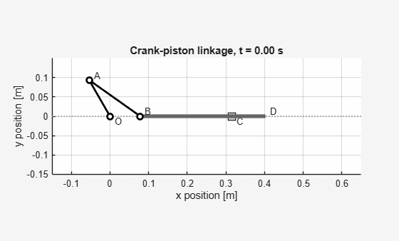
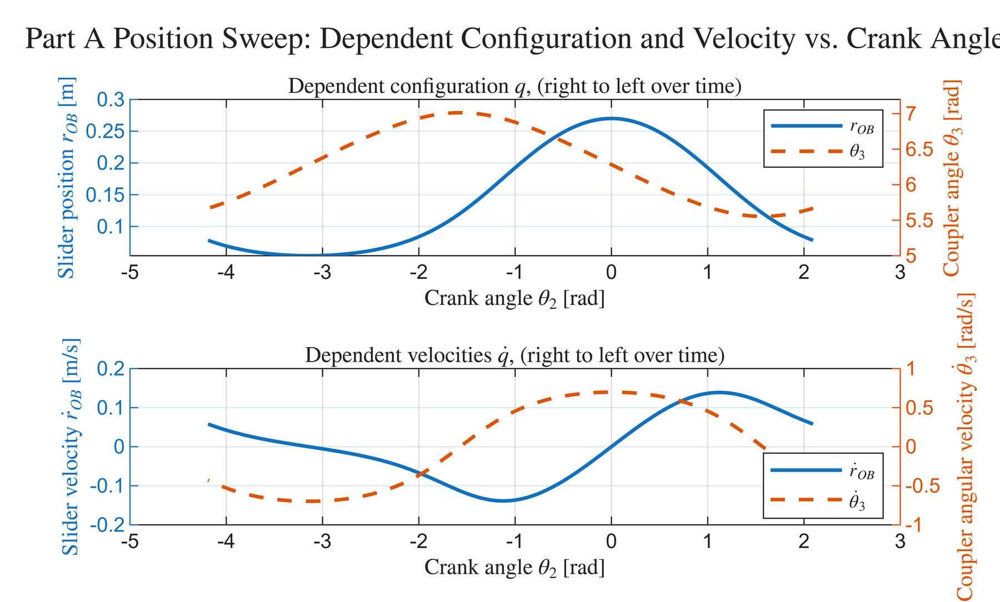
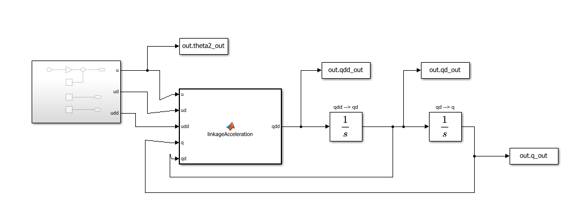
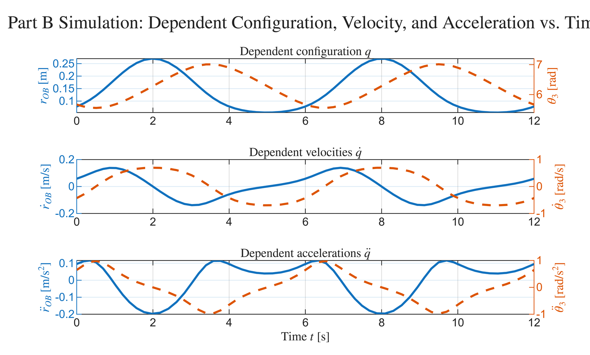
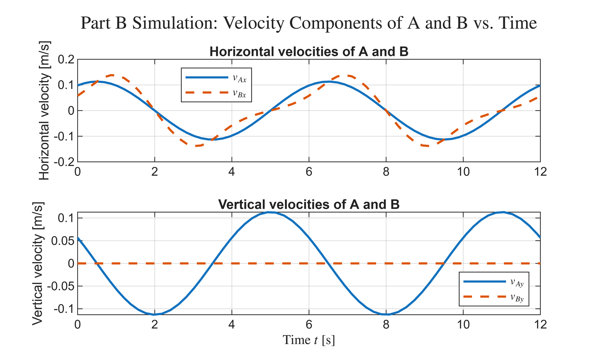
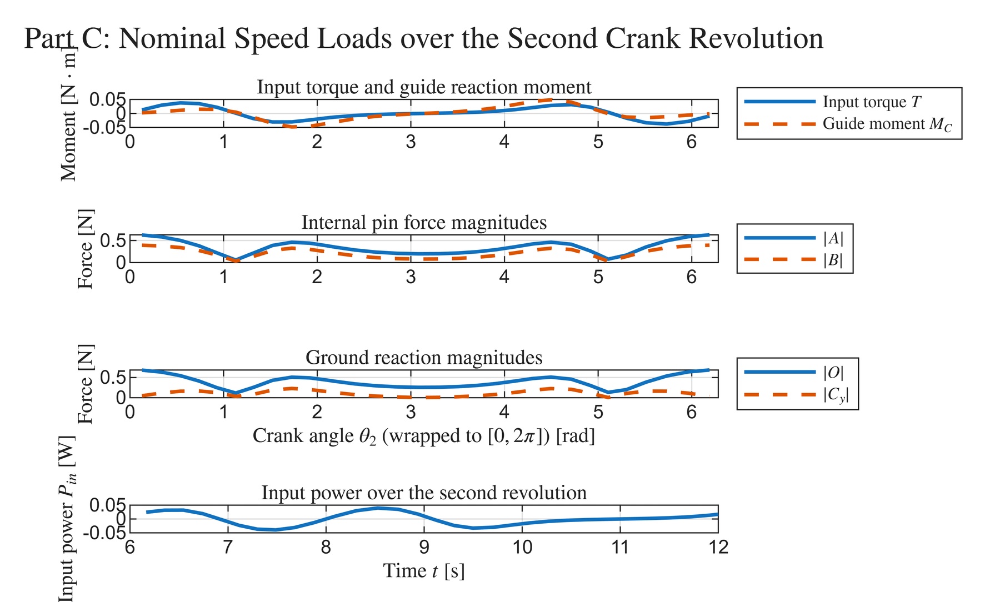
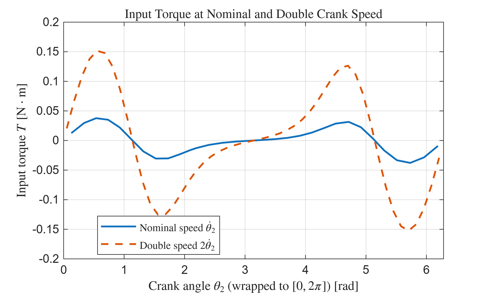

# Crank-Piston Linkage: Kinematics, Simulation, and Load Recovery

**ME 3319 – System Dynamics | Cal Poly San Luis Obispo**
**Tools:** MATLAB · Simulink · `fsolve` · ode45



## Overview

A crank (OA) drives a coupler (AB) connected to a piston rod (BD) that slides horizontally through a fixed guide at C. Starting at θ₂ = 120°, the crank is driven clockwise at a constant 10 rpm.

I built a full analysis pipeline in MATLAB and Simulink to answer two questions:
1. **How does the mechanism move?** This means the positions, velocities, and accelerations of every link over two crank revolutions.
2. **What loads does it see?** This means the pin reactions, guide forces, and the input torque needed to drive it.

The analysis has three stages, and each one builds on the previous one.

| Stage | Method | Output |
|---|---|---|
| **A: Position & velocity** | Vector-loop constraints solved with `fsolve` + analytic Jacobian | Slider position, coupler angle, and their rates vs. crank angle |
| **B: Acceleration & simulation** | Acceleration equations in a Simulink MATLAB Function block, double-integrated with ode45 | Time histories of q, q̇, q̈ and an animation of the linkage |
| **C: Kinetics** | 9 Newton–Euler equations assembled as a linear system $K\,y = d$ | Pin/guide reactions, input torque, and input power |

---

## Part A: Position and Velocity Kinematics

A closed vector loop O → A → B gives two nonlinear constraint equations in the dependent coordinates $q = [r_{OB};\ \theta_3]$:

```math
\Phi(q,\theta_2) = \begin{bmatrix} r_2\cos\theta_2 + r_3\cos\theta_3 - r_{OB} \\ r_2\sin\theta_2 + r_3\sin\theta_3 \end{bmatrix} = 0
```

Because $\theta_3$ appears inside trig functions, every crank angle has **two valid assemblies**. I solved the constraints with `fsolve` using the analytic Jacobian $J$, and seeded each step with the previous solution, so the sweep stays on the intended assembly branch across a full revolution. Differentiating the constraints gives the linear velocity equations $J\dot{q} = b_v$.

**Verification:** an independent rigid-body relative-velocity check ($v_B = v_A + \omega_3 \times r_{B/A}$) matched the matrix solution to **~7×10⁻¹⁸ m/s**, which is machine precision.



- Slider speed peaks when the **crank is roughly perpendicular to the coupler**. At that point all of A's velocity is directed along the coupler into the slider.
- Coupler angular speed peaks at **θ₂ = 0**, where the crank and coupler line up and the slider is momentarily at rest (dead center).

---

## Part B: Acceleration Kinematics and Simulink Simulation

Differentiating again gives $J\ddot{q} = b_a$. I implemented this in a Simulink model: a MATLAB Function block computes $\ddot{q}$ from the crank input and the current state, and two integrators produce $\dot{q}$ and $q$ from the Part A initial conditions.





**Validation against Part A:** I compared the integrated configuration to the algebraic `fsolve` solution at matching crank angles over two full revolutions. The maximum drift was:

| Quantity | Max absolute difference |
|---|---|
| Slider position $r_{OB}$ | 1.0 × 10⁻⁶ m |
| Coupler angle $\theta_3$ | 4.4 × 10⁻⁶ rad |

Both are on the order of the solver's relative tolerance (10⁻⁶). The simulation holds the constraint closely and never jumps to the other assembly branch.



---

## Part C: Kinetics and Load Recovery

With the motion known, free-body diagrams of the three moving links give **9 Newton–Euler equations** that are linear in 9 unknown loads:

$$K\,y = d, \qquad y = [O_x,\ O_y,\ A_x,\ A_y,\ B_x,\ B_y,\ C_y,\ M_C,\ T]^T$$

I solved this system at every simulation time step to recover the pin reactions, guide force and moment, and the input torque needed to maintain constant crank speed.



**Key findings:**
- **Peak pin loads occur at θ₂ = 0** (|A| ≈ 0.65 N, |B| ≈ 0.4 N). The crank and coupler are collinear there, their centripetal accelerations add, and the links must decelerate the rod and reverse its direction.
- **Input power alternates sign.** The motor puts energy in while the slider speeds up and takes it back while the slider slows down. With no friction in the model, net work over a cycle is zero.

### Speed-squared scaling check

Every acceleration in the model scales with $\dot{\theta}_2^2$ at constant crank speed, so doubling the speed should roughly **quadruple** the inertial loads. I reran the full pipeline at 2× speed to test this.



Peak torque rose from **~0.04 N·m to ~0.15 N·m (≈ 3.75×)**, close to the predicted 4×. The doubled-speed curve has the same shape as the nominal one, just scaled up.

---

## Repository Contents

```
crank-piston-linkage/
├── matlab/
│   ├── crank_piston_analysis.m          # Full analysis (plain-text, readable on GitHub)
│   ├── ME3319_Lab5_JonathanSiegel.mlx   # Original MATLAB Live Script
│   └── Lab5B_LinkageKinematics.slx      # Simulink model (Part B)
├── figures/                             # Result plots
└── docs/
    └── ME3319_Lab5_Report.pdf           # Full report with derivations and hand calcs
```

**To run:** open MATLAB in the `crank-piston-linkage/matlab/` folder and run `crank_piston_analysis.m`. The Simulink model reads its parameters and initial conditions from the workspace, so start from the script. It also exports an animated GIF of the linkage.

## What I'd Extend Next

- **Add gravity and joint friction.** Link weights (~10–20 N) far exceed the inertial loads at 10 rpm, so they would dominate the reactions and break the speed-squared scaling.
- **Forward dynamics.** Prescribe motor torque instead of crank motion, and solve for the resulting crank acceleration, which turns load recovery into a true dynamic simulation.
